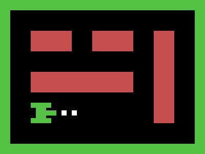

# Target #120 - Tank

Battle: #20 - Hover

- CSSBattle target: https://cssbattle.dev/play/120
- Saved submission: https://cssbattle.dev/submission/fdPeBgOnOUxLlCVb4mlI
- Submitted: 2022-08-22T10:45:50.658Z
- Score then: 648.67
- Score now: 648.67
- Score now collected: 2026-08-23T01:04:14.062Z
- Match: 100%
- Characters: 221
- Characters on current submit: 221

## Reference image



## Rendered output


## Solution

```html
<body bgcolor=0>▜▛ ▔▗▖<a>▖▖</a>    ▟▙<p>█<style>html{color:54C144;border:solid+5vw}a{color:fff}*+*{font:5vw/25%a;margin:52%77%0%40}p{color:C74E4E;margin:-402%0;zoom:20;clip-path:pat\68('m0 0v4h10v2H0V2h4V0h2v2h4V0h2v9h2V0
```

## Files

- `solution.html` - extracted HTML/CSS solution
- `reference.png` - official target image
- `rendered.png` - solution rendered in Chrome at 400x300
- `metadata.json` - target metadata and score details
