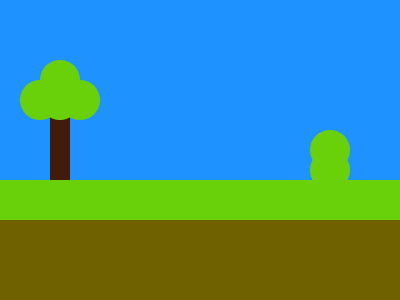

# Target #121 - Duck Hunt

Battle: #20 - Hover

- CSSBattle target: https://cssbattle.dev/play/121
- Saved submission: https://cssbattle.dev/submission/k2qLyEsZseJPntWaQihx
- Submitted: 2022-08-29T10:26:25.816Z
- Score then: 617.22
- Score now: 617.22
- Score now collected: 2026-08-23T01:04:14.062Z
- Match: 100%
- Characters: 330
- Characters on current submit: 330

## Reference image



## Rendered output


## Solution

```html
<body bgcolor=1E92FF style=box-shadow:inset+0-87q#6f6100,inset+0-129q#69d10a;width:9in;height:8cm><p><i><style>*{position:fixed;margin:0}p{width:20;height:80;background:#441A0A;top:100;left:50}i{background:#69d10a;width:40;color:69d10a;height:40;top:80;left:40;border-radius:50%;box-shadow:0-5vw,-5vw 0px,5vw 0,90vh 50px,90vh 70px
```

## Files

- `solution.html` - extracted HTML/CSS solution
- `reference.png` - official target image
- `rendered.png` - solution rendered in Chrome at 400x300
- `metadata.json` - target metadata and score details
