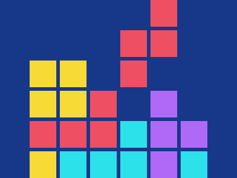

# Target #122 - Tetris

Battle: #20 - Hover

- CSSBattle target: https://cssbattle.dev/play/122
- Saved submission: https://cssbattle.dev/submission/wNOoTVh9VFkN3aeEUwtY
- Submitted: 2022-08-29T10:14:51.999Z
- Score then: 606.27
- Score now: 606.27
- Score now collected: 2026-08-23T01:04:14.062Z
- Match: 100%
- Characters: 436
- Characters on current submit: 436

## Reference image



## Rendered output


## Solution

```html
<style>*{background:#173889}*>*{position:fixed;left:42;top:145;width:45;height:45;background:#F8DA37;color:EE4F63;box-shadow:51px 0#F8DA37,51px -51px#F8DA37,0 -51px#F8DA37,0 102px#F8DA37,0 51px,51px 51px,102px 51px,102px 0,153px -51px,153px -102px,204px -102px,204px -153px,204px 0#B069F7,204px 51px#B069F7,255px 51px#B069F7,153px 51px#2CE1EA,153px 102px#2CE1EA,204px 102px#B069F7,255px 102px#2CE1EA,102px 102px#2CE1EA,51px 102px#2CE1EA
```

## Files

- `solution.html` - extracted HTML/CSS solution
- `reference.png` - official target image
- `rendered.png` - solution rendered in Chrome at 400x300
- `metadata.json` - target metadata and score details
