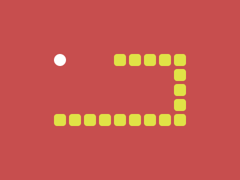

# Target #123 - Snake

Battle: #20 - Hover

- CSSBattle target: https://cssbattle.dev/play/123
- Saved submission: https://cssbattle.dev/submission/VVoVfIJ9cNct2MD9WKE4
- Submitted: 2022-08-30T11:27:50.728Z
- Score then: 627.74
- Score now: 627.74
- Score now collected: 2026-08-23T01:04:14.062Z
- Match: 100%
- Characters: 280
- Characters on current submit: 280

## Reference image



## Rendered output


## Solution

```html
<style>*>*{color:e0e246;border-radius:6q;margin:190 315 90 65;box-shadow:26q 0,53q 0,79q 0,25vw 0,132q 0,50vh 0,185q 0,50vw 0,238q 0,238q -26q,238q -53q,238q -79q,238q -25vw,50vw -25vw,185q -25vw,50vh -25vw,132q -25vw}*{background:radial-gradient(1in at 25%25vw,#fff 11q,#C74E4E 0
```

## Files

- `solution.html` - extracted HTML/CSS solution
- `reference.png` - official target image
- `rendered.png` - solution rendered in Chrome at 400x300
- `metadata.json` - target metadata and score details
